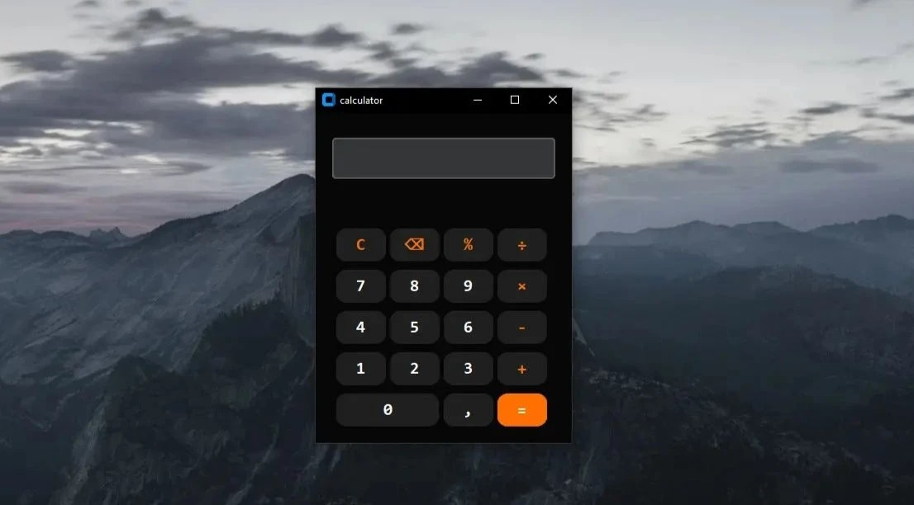

# Py Calculate
### a calculator with a graphical interface written in CTk  
  

## How does it work?
After installing the program, it is recommended to open the .exe file, as it launches faster and without a console window. Once opened, you will see a standard calculator that you are free to use.

## regarding the development:
Since the code is open-source, you are free to use it for your own purposes: add features,  
fix bugs, or do anything else that comes to mind.

## Files:
You might wonder: how do these files differ?
- main.exe - a file just to run the program
- main.py - The file where you can interact with the code opens more slowly because a terminal needs to be launched.

#### create by Blaybe ❤️
